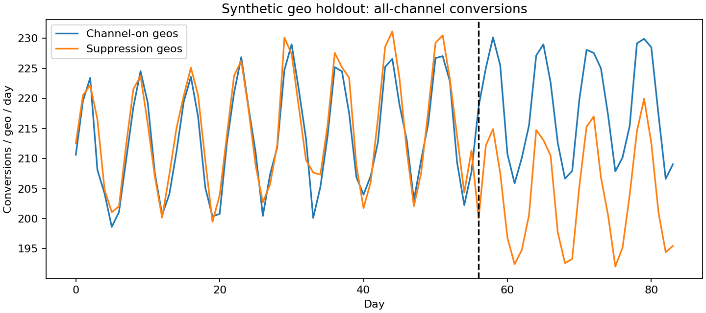

# Paid Marketing: Randomized Geo Incrementality

> Independent portfolio simulation. All data and numerical results are synthetic. No company data, proprietary code or internal methods are included.

## Business question

A fictional small-business software provider wants to know whether its affiliate channel generates additional sales or mainly takes credit for customers who would buy anyway.

This demonstrates experiment design, paired geo inference, difference-in-differences contrasts, attribution versus incrementality, incremental revenue ROAS and business interpretation.

## Quick start

Python 3.12 is recommended (the version used for verification). Run from this repository's directory:

```bash
python -m venv .venv
source .venv/bin/activate
pip install -r requirements.txt
python run.py
python -m unittest discover -s tests
```

On Windows use `.venv\Scripts\activate` to activate the environment. Data, analysis outputs and charts are already included so you can inspect the case without installing dependencies. Running the script recreates them with a fixed seed. Internet is needed only to install dependencies. For tightly reproducible environments see `VERIFICATION.md` for the versions used in the supplied run; `requirements.txt` allows compatible versions.

## Design and methods

- 48 fictional geos grouped into 24 matched pairs; one geo per pair randomly assigned to channel suppression.
- 56 preperiod days and 28 experiment days; matching and planned spend fixed before assignment.
- Measure all-channel conversions and revenue. Attributed conversions are generated separately and intentionally include organic conversions.
- Compute treatment-minus-control pre/post contrast within each pair, then average across randomized pairs.
- Paired-t confidence interval plus 10,000 sign-flip randomization draws. Preperiod placebo contrast is a diagnostic.
- Invert suppression effect to estimate maintained-channel contribution in suppressed geos during the test. Divide incremental revenue by restored channel spend for iROAS.

## Results and interpretation

Read [the generated business memo](outputs/decision_memo.md), [machine-readable metrics](outputs/summary.json) and [data dictionary](DATA_DICTIONARY.md). All numerical outcomes are from the synthetic environment. Report intervals and limitations alongside estimates.



## Repository map

- `run.py`: data generation, estimation, diagnostics, SQL execution and reporting.
- `data/`: generated sample data; primary table `geo_daily.csv`.
- `sql/`: executable SQLite metric queries, also useful as warehouse query examples.
- `notebooks/walkthrough.ipynb`: guided analysis and reflection; Jupyter is optional and is not a pipeline dependency.
- `outputs/`: CSV tables, summary JSON, decision memo, chart and generated SQLite database.
- `tests/`: data and methodological invariant checks.
- `.github/workflows/verify.yml`: rerun and checks on GitHub pushes/PRs.
- `DATA_POLICY.md`: provenance and publication boundaries.
